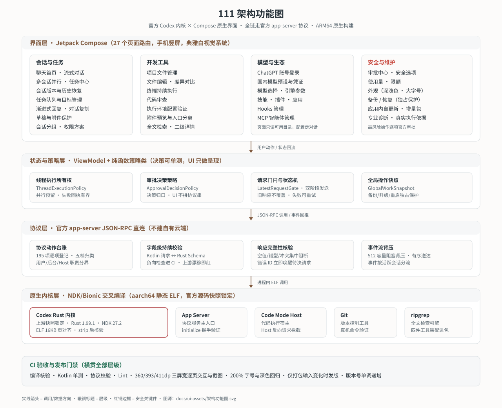

<div align="center">

# 111｜Codex Android 原生移动开发工作台

**把 OpenAI Codex 官方运行核心装进安卓手机**

Rust 内核经 Android NDK 原生编译 · Kotlin / Jetpack Compose 原生界面 · 全链走官方 `app-server` 协议


-263139)


</div>

---

## 架构总览

<div align="center">



</div>

四层结构，职责单一：**界面层**只做呈现，**状态与策略层**决策全部抽成可单测的纯函数，**协议层**直连官方 `app-server` 不建自有云端，**原生内核层**是官方源码快照的 NDK 原生构建。CI 验收与发布门禁横贯全部层级。

---

## 完整功能清单

### 会话与任务

| 功能 | 说明 |
|---|---|
| 聊天首页 | 进入应用直接发起对话，流式执行、渐进式回复 |
| 多会话并行 | 多任务同时后台执行，状态按会话隔离，侧栏任务中心统一管理 |
| 会话版本与历史 | 历史会话恢复时重新读取真实消息与任务事件 |
| 任务队列与目标 | 队列新增/编辑/排序/分页，执行额度事务式编辑（显式确认才生效） |
| 渐进式回复 | 长任务输出逐步呈现，工具调用链完整保留 |
| 对话复制 | 原生复制能力，长详情滚动可达 |
| 草稿与附件保护 | 未发送内容持久化恢复，正在执行的附件不清理 |
| 会话分组与权限方案 | 侧栏分组导航，首会话创建/切换期间的任务保护 |

### 开发工具

| 功能 | 说明 |
|---|---|
| 项目文件管理 | 工作区位于授权后的 `Download/Codex` 目录 |
| 文件编辑 · 差异对比 | 编辑、Diff 视图与任务对话同工作流切换 |
| 终端持续执行 | 真实 shell 命令，执行中状态保护 |
| 代码审查 | 审查页面与任务流联动 |
| 执行环境配置 | 先选运行位置，再配置和验证连接 |
| 附件预览 | 图片读取失败明确区分，入口与工具分离 |
| 全文检索 | 会话/工具调用链检索，同义词索引直达路由 |

### 模型与生态

| 功能 | 说明 |
|---|---|
| ChatGPT 账号登录 | 设备码 / 浏览器授权两种方式 |
| 国内模型服务商 | 内置预设模板，凭证本地管理，按需切换 |
| 模型选择 · 引擎参数 | 模型选择页 + 引擎参数滑杆 |
| 技能 · 插件 · 应用 | Codex 生态页面，外部内容保持原文不改写 |
| Hooks 管理 | 生命周期钩子配置 |
| MCP 智能体管理 | 对话中直接说"接入某个 MCP 服务"，由智能体完成配置认证与验证；页面只读展示真实可用目录 |

### 安全与维护

| 功能 | 说明 |
|---|---|
| 审批中心 | 高风险命令、文件修改、额外权限按官方协议逐项审批 |
| 安全选项 | 读取真实生效策略，只提交用户改动项 |
| 使用量 · 限额 | 真实额度数据，队列实验接口明确标注 |
| 外观 | 典雅白双模式（深浅色）、200% 字号可达 |
| 备份 / 恢复 | 进程级独占保护，迁移期间阻断一切写入 |
| 应用内更新 | 增量包优先、SHA-256 校验、系统安装器引导 |
| 专业诊断 | 真实执行依据，内部字段仅在主动展开时出现 |

---

## 快速上手

1. 从 [Releases](https://github.com/sy220284/111/releases) 下载 `codex-android-arm64` 正式版 APK（ARM64 手机，Android 10+）
2. 安装后进入聊天首页，完成账号登录（设备码或浏览器）
3. 在对话中直接描述任务——文件修改、命令执行会按官方协议弹出审批
4. 需要接入 MCP 服务时，直接在对话里说，智能体会完成配置并验证连接
5. 应用内「检查更新」走增量下载与系统安装器，无需手动刷机重装

> 模拟器 APK 仅用于内部验收，正式用户请使用 ARM64 手机包。

---

## 工作模型

```
聊天首页 → 项目 → 会话 → 执行 ┬→ 文件 / 终端 / 差异 / 审查
                            └→ 审批（官方协议逐项决策）
长期配置 → 设置页 · 上下文操作 → 弹层与队列 · 后台能力 → 内核与智能体
```

- 手机竖屏，顶部导航 + 抽屉侧栏，全中文界面（专有名词保留原名）
- 一级列表只留名称与动作，专业细节收进二级详情
- 用户数据按会话隔离持久化；不建设自有云端存储或 AI 服务

---

## 架构分层

| 层 | 组成 | 关键机制 |
|---|---|---|
| 界面层 | Jetpack Compose，27 个页面路由 | 典雅白 tokens 驱动，深浅双模式，动效含无障碍归零 |
| 状态与策略层 | ViewModel + 纯函数策略类 | 线程执行所有权、审批决策归口、请求票券门闩、双阶段发送状态机、全局操作快照 |
| 协议层 | 官方 `app-server` JSON-RPC 直连 | 协议动作台账、Kotlin↔Rust 字段级 CI 校验、响应完整性核验、512 容量背压 |
| 原生内核层 | Codex Rust 内核 + App Server + Code Mode Host + Git + ripgrep | 官方快照锁定，NDK/Bionic aarch64 静态 ELF，ELF 16KB 页对齐，strip 后核验 |
| 发布链 | 正式签名 + 输入寻址复用 | 仅打包输入变化时发版，版本号单调递增 |

---

## 文档索引

| 文档 | 内容 |
|---|---|
| [AGENTS.md](AGENTS.md) | 开发与优化执行规则（权威文件之一） |
| [接口协议动作清单与落地验收台账](docs/接口协议动作清单与落地验收台账-20261122.md) | 官方协议逐项对照与验收证据（权威文件之一） |
| [系统架构](docs/系统架构.md) | 分层设计与数据流 |
| [设计系统](docs/设计系统.md) | 审美、材质、布局、动效规范 |
| [协议与页面契约](docs/协议与页面契约.md) | 页面 ↔ 协议契约 |
| [验收矩阵](docs/验收矩阵.md) | 真实构建与设备日志核验结果 |
| [正式发布流程](docs/正式发布流程.md) | 版本门禁与签名配置 |

---

## 构建与验收

| 工作流 | 职责 |
|---|---|
| 编译 Android 原生 Codex 核心 | ARM64 内核与依赖工具构建验证（编译输入复用） |
| 安卓界面与协议独立验收 | Kotlin 单测、协议、Lint、三屏宽模拟器交互与截图 |
| 安卓版本构建与验证 | ARM64 APK 构建与二次完整性核验，同提交自动去重 |
| 安卓原生上游升级预演 | MXC / Code Mode 升级兼容性 |
| 手动同步官方源码 | 指定上游 SHA，生成中文审核 PR |

**验收基线**：Android 35 模拟器 360/393/411dp 逐页交互测试与截图证据，200% 字号与深色模式回归；正式发布要求同一源码提交的 APK 核验与设备验收全部成功。

## 关键原则

- 功能真实可用以服务器返回和设备验证为准，不建设假接口
- 用户数据本地持久化、按会话隔离；不建设自有云端数据存储或 AI 服务
- 高风险操作按官方协议单独审批，决策归口单一策略层
- 官方源码保留并可追溯，升级逐一比对协议变化

上游 Codex 授权见 `upstream/codex/LICENSE` 与相关 NOTICE。
