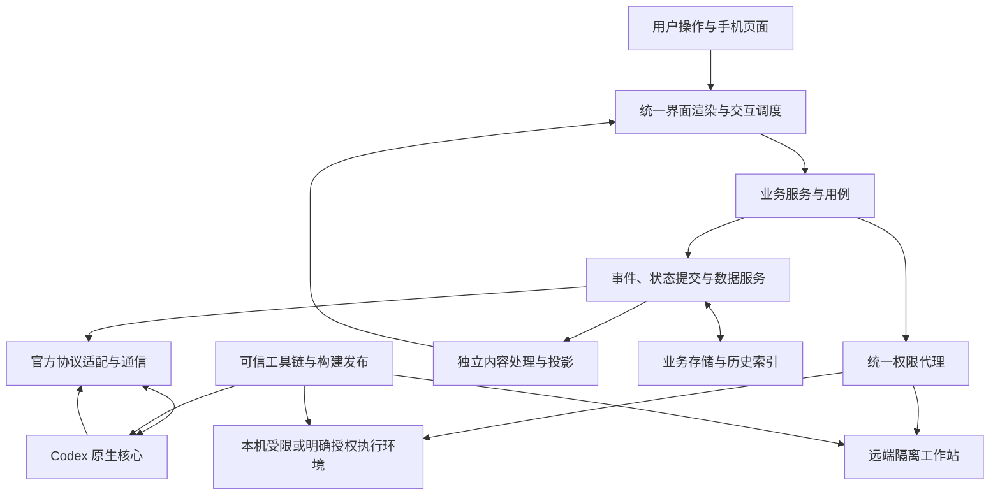
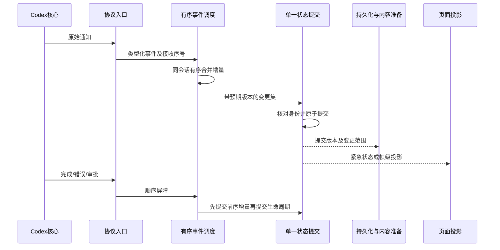
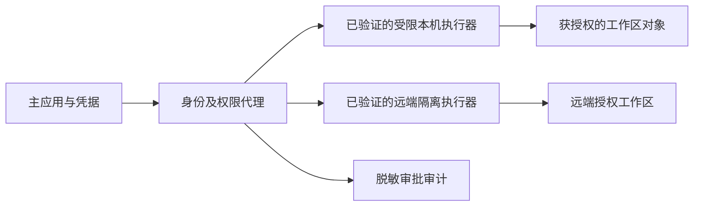
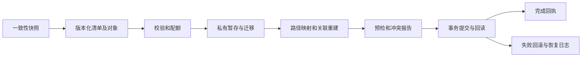

# 111 架构设计规范 3.0

> 状态：项目级权威架构规范（目标态及强制演进约束）
>
> 版本：3.0；首次确立日期：2026-11-26；适用：111 Android 客户端、原生 Codex 核心适配、远端执行器、工具链、构建与发布。
>
> 架构调查基线：PR #116，源码抽查基线 9eb2cc6abb70a07be084e47d71afbfdd8d3a303a；同期权威规范复核基线 2deeeb9038eee032b4d155cf4ee42a500b50275d。基线用于追溯，不冻结后续实现。本文所述目标、拟定预算及设计契约须逐项验收，不作为当前已通过的实测报告。

## 0. 文档权威与使用方式

[现行实现与文档维护索引](现行实现与文档维护索引.md) 分别登记已发布版、主线、候选的源码与证据。本文始终为目标和约束；实现映射随候选变化核对，不能将草稿的实现写成当前 main 的功能。

111 长期维护三份权威文件：

| 文件 | 唯一职责 |
|---|---|
| [AGENTS.md](../AGENTS.md) | 产品范围、体验、研发纪律、PR 与交付规则；所有任务首先读取 |
| [接口协议动作清单与落地验收台账](接口协议动作清单与落地验收台账-20261122.md) | 官方协议逐项事实、UI 归属、真实调用路径、实现和验收证据 |
| 本文 | 整体系统边界、模块依赖、数据与控制流、跨模块架构契约、迁移原则、性能及安全验收标准 |

官方锁定 Rust DTO 与 UI 归属生成源 `android-app/tools/ui_surface_policy.json` 继续决定协议事实；禁止架构设计自行创造官方接口、字段或授权。三个文档按职责共同生效，发生冲突先核对真实契约和现行产品要求，再在同一 PR 内修正受影响条款；不得降低原联合门禁。旧 [系统架构](系统架构.md)、历史 PR、历史方案作为追溯资料，本文接管目标架构决策，已有有效实现与回归不因此失效。受信联系人服务明确不在交付范围。未经要求不引入付费设备或定时任务。

**强制阅读与变更规则**：新增功能先选定所属业务服务、权威数据源、身份边界、订阅和验收路径；涉及多个页面的能力必须下沉共享层。每次架构 PR 说明涉及的本文条款 ID、现状与目标、旧路径退出策略、协议影响、测试及证据；新决策更新本文相应章节，不再积累相互冲突的孤立规范。本文只记录架构要求，逐接口和逐候选的实际证据归入接口台账与联合验收记录。

## 1. 产品定位、目标与不变量（ARC-01）

以官方原生 Codex 核心为事实和执行基础，提供完整的手机竖屏 Android 工作台：对话、项目、会话、文件、差异、终端、审批、目标、队列、账号、模型、技能、插件、MCP、设置与诊断。保留现有原生能力与真实反馈；持续降低新增功能接入和维护成本。

- 一次构建共享能力，所有页面和新增功能自动获得有界资源、统一权限、生命周期管理、局部更新与一致交互。
- 单一权威数据源、明确写入所有者、原子提交、可追溯身份；派生视图和缓存可重建。
- 后台处理与界面刷新分离，成本随本次变化及可见范围增长，尽量不随完整历史线性增长。
- 原生协议语义、完整内容、原文复制、审批与终态、文件完整性、隐私、真实执行和恢复能力优先于性能捷径。
- 不以搬目录、增加中间层数量、简单线程迁移、只读缓存命中率或局部微基准作为架构完成标准。

非目标：重写官方 Codex、复制核心数据库作为第二事实源、模拟不存在的服务端能力、统一所有数据为一个巨大 StateFlow、为未来不确定需求建立空壳框架。保持手机 Download/Codex 共享工作区的产品约定，隔离工作区交付边界见第 8 节。

## 2. 系统拓扑与分层（ARC-02）

箭头表达调用或数据流，编译依赖遵循下表，不照图制造循环依赖。权限代理在所有执行路径的实际入口和执行边界强制生效，图中直连核心的协议通道也不能绕过它。

| 层级 | 职责 | 依赖方向与所有权 |
|---|---|---|
| 用户交互 | 页面、导航、输入、操作与反馈 | 依赖 UI 和业务接口，不直接操作核心 JSON、磁盘或进程 |
| 统一渲染 | 局部订阅、帧调度、布局、组件、动效与无障碍 | 依赖不可变展示模型、设计系统与业务操作契约；不拥有权威状态 |
| 内容及业务服务 | 会话、回复、任务、文件、工具、账号、MCP、迁移、配置 | 依赖核心领域端口；管理业务用例，不持有 Compose |
| 事件与数据 | 协议事件、调度、唯一写入、快照、索引、生命周期、持久化 | 向业务提供版本化接口；不依赖页面 |
| 核心与安全 | 原生核心、传输、本机/远端执行、身份与权限代理 | 通过端口隔离平台实现；以真实回执约束业务状态 |
| 基础设施 | 可信工具链、产物、构建、自动验收、发布 | 供应不可变依赖与运行环境；不得反向依赖 UI |

组合根创建连接、服务和调度器；依赖通过明确构造参数传入。应用作用域管理账号、连接、数据库和运行时；账号作用域管理会话目录、配置与授权；会话作用域管理历史、活动、任务和回复；页面作用域只持有展示订阅、滚动及未提交的临时输入。退出页面取消展示计算，后台任务按真实生命周期继续；切换账号必须取消、清理旧所有权和安全数据。

### 2.1 模块组织及迁移边界

当前 Gradle 设置为单个 `:app`，下列为目标逻辑模块路径与编译依赖设计，按实际依赖图先建立包边界、测试边界，稳定后再拆 Gradle 模块。禁止为了目录形式增加转发类。

| 模块 | 对外责任/端口（命名为设计约定） | 允许依赖 |
|---|---|---|
| core/protocol | ProtocolCodec、类型化 RPC/通知/请求响应 | 锁定官方契约、基础类型 |
| core/event | EventIngress、EventScheduler、会话邮箱、顺序屏障 | protocol、state 端口 |
| core/state | StateTransaction、快照、变更集、投影订阅 | 领域类型、storage 端口 |
| core/session | SessionService、生命周期和任务/回复归属 | event、state、protocol/transport 端口 |
| core/storage | 历史索引、元数据、对象及事务存储 | 平台存储、领域类型 |
| core/security | Principal、Capability、审批、审计、执行授权 | 平台安全、领域类型 |
| core/runtime | RuntimeSupervisor、运行环境探测与执行端口 | security、transport |
| core/transport | 本地 stdio、远端连接、RPC 租约、流量限制 | protocol、security 端口 |
| core/transfer | FileTransfer、MigrationCoordinator、备份 | storage、security、transport |
| service | Reply、Task、File、Account、MCP、Config、Tool 用例 | core 公开端口 |
| render/engine | ReplyDocumentEngine、解析、投影与调度 | render/content、不可变领域模型 |
| render/content | 富内容模型、稳定块、原文映射与渲染器协议 | 纯模型 |
| ui/designsystem | 组件、设计 token、动效、焦点、无障碍 | Compose、展示模型 |
| ui/navigation | 页面路由、作用域生命周期、返回与深链 | feature 公开入口 |
| feature/conversation、sessions、terminal、workspace、extensions、settings | 页面和业务操作绑定，按功能细分 | service、render、ui 公开 API |
| infrastructure | 上游适配、产物索引、工具链、CI/发布 | 构建系统、各模块测试契约 |

领域模型和端口可进一步分包以解除循环；实现只向稳定端口依赖。ViewModel 负责页面投影、用户命令及生命周期桥接，逐步移出 JSON 解码、状态归并、索引构建、网络/磁盘工作、授权执行与渲染解析；迁移过程中保留所有权校验及线程约束。架构检查须验证无依赖环、禁止 UI 调用内部传输和存储实现、单写入入口、受控执行入口覆盖率；允许的例外需记录原因、替代方案和移除条件。

## 3. 统一协议、事件处理与生命周期（ARC-03）

### 3.1 事件入口和身份

`CodexConnection` 收到原始线缆消息后在协议入口解析一次，形成类型化事件；内部 envelope 至少含账号代次、核心/连接代次、环境身份、会话/回合/项标识（按真实协议存在性）、接收序号、事件种类、负载、关联请求 ID。内部序号与版本为本地元数据，不冒充官方服务端字段；保存原始内容用于诊断或确有协议需要时再物化，脱敏并限制大小。无法识别的方法保留安全失败语义及诊断；审批请求及时应答，禁止默默丢弃未知关键事件。

### 3.2 调度和可靠性

| 事件类别 | 必须遵守的处理规则 |
|---|---|
| 审批、错误、完成、断开、权限撤销 | 保留严格因果序，禁止合并掉终态；同会话先冲刷此前增量；无关会话的关键事件不得等待大块解析 |
| 正文、命令输出、进度 | 只合并同身份、同回合、同项、同种类的连续可合并事件；按原顺序分块追加，有数据即处理，无数据才挂起 |
| 请求响应 | 按请求 ID、发起身份、连接代次与租约匹配；超时/断开/取消恰好终结一次；未知或旧响应不更新当前界面 |
| 全局账号/连接/配置事件 | 使用全局顺序屏障与代次；跨会话影响需明确提交一致性边界 |

目标采用有界入口、单会话唯一写入者、不同会话独立调度，并给全局事件设置显式屏障。接收序、业务状态序、持久化版本和展示版本分别记录。优先级只决定跨独立工作单元调度和投影刷新，不能将同一因果链完成事件越过内容。队列高水位时批量消费或对传输施加背压；关键事件保留容量，正文不可截断，无法可靠继续时明确失败并从官方权威状态重同步。限制每轮处理预算，避免活跃会话饥饿；不能以无限 Channel 解决拥堵。

后台纯计算使用不可变输入；提交时再次核对账号、连接、会话、快照身份与预期版本，冲突重算必要范围，旧世代结果废弃并计数。当前 `TimelineEventEngine` 已有后台准备及 Main 校验提交的路径，不能直接把整个 ViewModel 移到后台；目标将提交所有权下沉，Main 只消费 UI 安全快照。CPU 解析、IO 持久化、协议读写、UI 帧发布使用独立有界调度资源。取消读/解析/投影不取消已提交的权威事件；用户停止任务走真实核心请求，等回执/重同步判定终态。恢复时通过官方读取/恢复契约及本地事务检查重建，不假设服务端具有通知重播或全局 exactly-once 能力。

### 3.3 状态机与并发验收

连接：未连接 → 启动/握手 → 就绪 → 断开/重连 → 新代次就绪；账号切换使旧租约失效。任务：已提交请求 → 待回执 → 运行/等待审批或输入 → 真实完成/失败/取消；断线期间显示未知或恢复中，查询真实状态后收敛。审批：待决 → 正在响应 → 已确认/失败/过期，仅原请求范围授权；重复点击不重复执行。历史、活动、任务终态在同一个提交边界可观察。

必测：随机分块与不合并原始事件对照、同会话顺序、跨会话并发、公平性、完成前最后增量、重复/迟到/取消、账号切换、断线重连、队列过载、异常及落盘重启。记录丢失数、积压峰值、各阶段延迟、旧世代拒绝数、最终内容摘要和真实终态。

## 4. 会话、状态与索引（ARC-04）

| 数据单元 | 写入所有者 | 持久化与读取 |
|---|---|---|
| 会话目录 | SessionDirectory/会话服务 | 核心真实目录为源，本地增量索引和分页；归并、置顶、搜索、排序后台执行 |
| 历史回合 | 历史存储/会话提交者 | 原生 ID、顺序、回合及完整历史，稳定不可变分段；按游标、锚点分页 |
| 活动回合 | 会话状态提交者 | 当前活动索引、运行状态、局部变更；结束后原子归档 |
| 回复内容 | 会话提交者 | 不可变文本分块、结构化内容及版本；解析缓存可重建 |
| 任务、审批、队列、目标 | 任务服务及会话提交者 | 真实回执、阶段、错误和关联 ID；核心事实优先 |
| 输入与附件 | Composer/草稿服务 | 即时输入状态、异步持久化、附件对象关联；发送成功按回执清理 |
| 配置、账号 | 各服务唯一写入者 | 独立订阅；密钥不进入普通状态、备份或日志 |
| 工具、终端、MCP | 各服务唯一写入者 | 按功能订阅、执行回执、活动输出；受控权限与生命周期 |

状态事务概念契约：`commit(expectedVersion, identity, changes) -> committedVersion + ChangeSet`；ChangeSet 标明受影响实体、字段或范围；读者通过同版本一致性读取获得关联单元。内部共享不可变结构，提交后的快照不得原地修改；缓存 key 必须包含来源身份、语义版本、解析/索引版本及相关配置。历史分页插入、回合归属改变或晚到通知需重新核查受影响区间，不能直接当作尾部追加。

保留 `IndexedTimeline`、`PersistentTimelineCollections`、`TimelineTextChunks`、`TimelinePresentationEngine` 等基础能力。目标历史与活动拥有独立管理及投影；目前二者展示投影已可分离，但不能宣称权威物理存储已完全拆分。活动回合移入历史时保留原生 ID、原文、索引和阅读坐标，迁移前后重复/缺失为零。目录缓存预排序逻辑族和标题索引，查询变动只计算必要筛选；账号、源版本、置顶、远端绑定变化精确失效。全文/历史索引支持直接按 ID、时间/逻辑顺序、标题及原文位置定位，不因视觉分页复制逻辑记录。

算法要求：普通索引更新共享树路径与有限叶段（当前至多32条）；有序遍历采用迭代，避免逐条树查询；区间查找采用二分/前缀跨度；长序列追加不反复复制完整历史；实际工作量以变更规模为准，允许合法重组，不宣称所有操作 O(1)。对照随机操作、5000+历史、分页恢复、置顶/搜索/归属变动、重连、重复 ID、并发线程；报告 CPU、分配量、持久化和投影范围。

## 5. 统一原生回复引擎（ARC-05）

数据链：原生回复分块 → 增量边界扫描 → 结构化文档 → 后台准备/缓存 → 可见块原生渲染 → 共用原文导航、选择、复制、分享、导出。Markdown、内联样式、链接、代码、公式、表格、图表、流程图、时序图、文件、媒体、异步回复、MCP 托管内容采用统一生命周期和展示调度；不同信任级别的内容保留独立安全渲染器。新增类型注册一次内容解析/准备/展示/原文访问/资源释放契约，禁止复制整套流式解析链。

### 5.1 统一内容模型

文档标识由账号/会话/回合/原生项及文档版本组成；块模型包含稳定 ID、类型、原文范围（明确 UTF-16/Unicode 映射）、结构化数据、内联 token、布局/交互属性、信任等级、资源引用与稳定状态。ID 来源与逻辑锚点独立于物理页、可见位置和临时随机数。原文是复制、选择、目录、导出、链接和回读的共同事实；派生 HTML 按安全规则过滤。选择跨页时使用冻结文档版本和绝对原文坐标，避免根据可见文本猜测。

| 内容阶段 | 处理与显示 |
|---|---|
| 已稳定 | 原样复用解析/布局准备及块标识；语义变动才失效 |
| 正在生成 | 立即显示可用轻量原文；后台按批/预算更新尾部；保留阅读位置 |
| 未闭合复杂语法 | 临时轻量预览；结构完整后升级为组件，禁止伪造公式或结构 |

前缀复用须处理围栏、缩进、表格分隔行、引用/列表、链接引用定义等跨块语义：建立解析边界与引用依赖；新增内容影响前文时从最早受影响边界重新解析，必要时全量重建但记录原因，不能把稳定前缀无条件当永久正确。完成/撤销/替换/重连后按原始最终文档与全量解析逐字对照。每种已支持语法有正负样例、Unicode、混合内容与未闭合输入回归；完整 TeX/Mermaid 语言仍按真实支持范围登记。

### 5.2 可见范围、复杂块与资源预算

普通正文外层使用稳定分页和懒加载；当前默认每页至多8个普通块，尾页按需生成，原生 ID 和最后一页操作保持。超长纯文本按 Unicode 安全边界切片；代码内部按当前 3200 UTF-16 单元/32行准备切片及复用高亮 token；表格固定表头、行懒加载、每组至多12列，选择映射原始行列。上述是现有约束与起始配置，不改变原文和样式，调整须有基准与回归。单个巨大公式、图、时序图或媒体采用独立有界计算和必要的视口裁剪，保留真实内容访问、缩放、错误及取消；不以简化数据代替完整表达。

数学、图布局、代码高亮、媒体探测分别限制并发、时间和缓存字节；缓存有大小/条目上限、按权重淘汰、内存压力回收；不可变准备结果按来源及渲染器版本共享。禁止把 10 万字符转成一个 Compose 节点或在主线程全量解析。模型生成代码、HTML、链接、文件引用均视为不可信数据；原生内容不自动执行，MCP App 采用受限托管宿主和授权通道，不与普通 Markdown 混为一体。

验收：1万/5万/10万字符，单个超长代码、数千行/宽表格、公式、流程/时序、媒体及混合文档；随机 token 分割与全量解析对照，完成态相等；跨页 Unicode/链接/目录定位、复制/导出、阅读锚点、快速停止、内存压力、隐藏页面、旋转配置恢复（维持产品竖屏限制）。同场景记录解析延迟、重用比例、可见组件数、内存峰值和帧时间。

## 6. 全局 UI 性能与交互（ARC-06）

统一 `PresentationScheduler` 概念边界：输入和点击即时；状态与文本按显示帧合并；CPU 密集内容后台准备；磁盘、网络及索引维护隔离调度，空闲低优先任务可取消。目标只提交有变化的投影，按账号/会话/页面作用域和版本订阅；错误、停止、审批、输入不得等下一批内容解析才反馈。现有 `collectFrameState` 类机制及投影缓存继续使用，所有页面以实测订阅范围确定是否已接入。

| 场景 | 共用契约 |
|---|---|
| 页面打开/侧栏 | 首先复用当前身份有效快照；首帧后后台刷新，空数据/错误明确区分 |
| 页面切换/动画 | 取消不可见展示任务，转场不竞争重型计算；保留草稿和滚动锚点 |
| 大列表/目录/执行过程 | 仅布局可见窗口及有界预取；默认最近5条已完成步骤 + 所有进行中步骤，完整历史分组分页 |
| 输入/附件/终端 | 输入即时同步，异步保存；真实输出完整落盘、显示有界，终态冲刷；可取消操作真实回执 |
| 设置/工具/MCP/账号 | 单项状态独立订阅；分页与懒加载；网络刷新保留旧有效快照并标注 |
| 复杂内容/文件 | 后台准备、有限缓存和加载进度；错误/重试/权限解释与实际执行一致 |
| 后台页面/内存不足 | 暂停非必要渲染、取消无订阅计算、按权重清理派生缓存，权威数据及待审批不丢 |

全局设计系统保持现有视觉 token、组件、动效、交互容器、竖屏抽屉、TalkBack/字体放大、输入法避让与触控目标；新增功能优先复用组件并按接口台账决定归属。全部页面逐页记录打开、滚动、刷新、操作、错误、回退及资源释放；不能只优化对话。状态订阅、IO/解析/排序、可见布局的静态规则与 Compose/设备追踪共同验收；不通过人工等待或固定延迟制造流畅假象。

## 7. 业务服务、连接与资源生命周期（ARC-07）

| 服务 | 入口与完成语义 |
|---|---|
| 会话/任务 | 创建、恢复、发送、停止、队列、目标、审批；按真实请求/回包及生命周期通知更新 |
| 回复 | 接收提交版本、生成文档与活动投影；完整原文/结构化内容保留 |
| 文件/工作区 | 当前身份、环境、授权根及路径校验；预览、编辑、差异、附件和交付共用规则 |
| 账号/配置 | 实际 OAuth/配置读取和修改回读；密钥隔离；切换使旧租约失效 |
| 工具/终端 | 能力探测、启动、PTY/子进程、退出、取消；统一执行授权和输出存储 |
| MCP/插件/技能 | 真实服务、分页目录、调用归属与授权；原调用授权和上下文更新须有官方核心通道，缺失时明确不可用 |
| 迁移 | 数据范围发现、备份、恢复、校验、事务和恢复报告 |

本地 stdio 与远端 transport 独立于业务；握手、版本协商、请求超时、断线重连、并发限制和失败传播复用。操作统一携带身份及请求租约，结果只更新同归属状态；不安全自动重试非幂等写入。进程结束须通知等待者、释放 FD/PTY、清理子进程和临时文件；超时可查询真实状态，不伪造完成。账号、环境、工作区、会话切换对旧请求、授权、文件暂存及投影有明确取消/失效策略。模型、图表等非执行内容与工具能力保持边界。

## 8. 执行安全与隔离（ARC-08，发布硬门禁）

### 8.1 威胁模型与边界

假定模型输出、工作区文件、终端命令、第三方 MCP/插件、远端响应、归档及可执行产物均可能恶意；防止读取主应用私有凭据、越权访问其他项目、未授权网络、子进程逃逸、路径穿越、符号链接竞争、权限混淆及运行时篡改。主应用可信持有账号凭据、配置、审批、业务数据；执行侧只收到按当前身份和具体操作授权的能力与数据，不能继承主进程完整环境、密钥或广泛 FD。

授权主体包含账号、连接代次、环境、会话/回合、调用方、工作区和实际请求；权限对象包含操作、文件范围/网络目的或工具、有效期、使用次数/生命周期、审批依据。授权代理统一发放、撤销、审计、拒绝；执行器在真实操作处重新核对，子进程、PTY 后续输入、MCP、插件、固定探测和后台任务均继承实际边界。拒绝时呈现真实能力、原因和可选授权路径；危险命令识别只用于改善确认体验，不能充当隔离边界。账号密钥留主应用或明确授权的可信核心组件，执行任务不直接访问。审计记录最小必要信息，敏感正文/令牌不写日志。

### 8.2 模式与 Android 可行性

| 模式 | 条件和用户可见承诺 |
|---|---|
| 受限本机 | 设备证明独立 UID/SELinux 或等效真实 OS 边界，命令只能访问受控工作区/工具与临时目录；网络默认拒绝，授权经强制通道 |
| 隔离工作站 | 独立工作站进程/容器或 VM 的文件、网络、用户及生命周期边界已验证；安全通道、设备身份、授权根及版本检查 |
| 明确授权的本机全权限 | 用户主动选择，清楚说明实际共享 UID/系统授权及风险；不能标称隔离，禁止从受限模式静默降级 |

Android 先验证 isolatedProcess 独立 UID、Binder 身份、FD 传递、native exec、PTY、子进程、SELinux、联网及共享目录；若能力不足，评估签名认证独立包 UID 或隔离工作站。主应用 Download/Codex 仍为真实共享工作区；受限执行器通过明确授权对象/FD 或受控事务同步访问必要数据，冲突报告与原文件回读必测，不能借授权代理获得主应用全部共享存储能力。Android 10 与 Android 11+ 的系统存储授权和撤销按 AGENTS 执行；不得创建隐蔽替代工作区。当前 Debug 探针或 externalSandbox 字段只作为能力调查，不作生产隔离凭证。

实现约束：路径逐级 no-follow 或等价原子安全打开，拒绝非普通文件/特殊文件和越界；避免先校验后不安全打开。FD 最小权限，关闭多余描述符。网络须由 OS/工作站边界强制，不能依赖 shell 字符匹配或环境代理变量；未授权 TCP/UDP/DNS、环回及子进程继承均验证。用户撤销、核心断开、会话/账号切换及任务完成时失效授权，终止或回收相关执行资源。记录可复核安全证据但不泄漏密钥。

验收矩阵：API 29/35/37及支持范围内 ARM64 真实设备、x86 模拟器补充，分别验证有效工作区读写、其他项目/私有文件/凭据拒绝、路径链接与竞争、网络开关、子进程/PTY、终止、断线、授权撤销、MCP/工具执行覆盖、重启恢复。未通过的模式不得标为可用；保持原联合安全与发布门禁。

## 9. 统一数据存储、迁移与传输（ARC-09）

### 9.1 权威数据分区

| 数据类别 | 权威源与规则 |
|---|---|
| 官方原始数据 | 锁定 Codex 数据格式、原始 rollout、真实任务/会话与官方 RPC；不自行改写不可迁移内部数据库 |
| 应用结构化数据 | 版本化会话索引、附件关系、草稿、项目登记、任务/目标的应用管理部分；事务及明确 schema |
| 文件对象 | 项目、附件、原始媒体、快照及分析产物；内容摘要、大小、类型和引用关系校验 |
| 安全数据 | 账号、密钥、可信授权和设备身份独立加密/平台保护；迁移时重新认证，不复用旧授权 |
| 派生临时数据 | 渲染、索引、缩略图、运行缓存，可重建；分级配额、生命周期及清理 |

业务模块登记版本化迁移清单：数据集、schema 版本、依赖顺序、导出/导入端口、身份映射、冲突策略、校验器、是否可重建、敏感性及恢复后验证。目标/队列/记忆等先逐项核查官方数据语义和真实接口；允许的逻辑数据通过受支持方式导出及导入，禁止整库盲拷或伪造官方 RPC。明确不支持的数据及原因，不漏报数据范围。历史原生 ID、应用 ID、文件路径、附件、分析结果间的关联必须重建一致。

### 9.2 备份恢复事务

使用快照或明确写入冻结边界取得一致数据；归档逐对象字节数、SHA-256、精确条目集合、总量/单项限额、安全路径及格式版本。PR #116 候选的备份 v4 完整性容器兼容 v1–v3，摘要防损坏，不宣称签名认证；恢复流程在暂存区校验、逻辑转换、重定位、检查冲突并封存暂存清单，提交前回读验证。写入使用日志及可恢复事务，进程死亡/断电后恢复到明确旧态或完成新态，禁止半恢复。保留原文件、非覆盖迁移和冲突处理；原始密钥及旧授权不导入。恢复完成后通过真实应用/核心读取验证会话、目标、草稿、附件、历史、工作区及分析产物的关联和可用性，完整报告缺失。已有容器格式完整性与完整业务逻辑迁移分别验收。

### 9.3 统一文件交付

本地、远端、附件、文件卡片/Markdown 链接、MCP 产物、预览、导出、备份共享 `FileTransfer` 能力与路径授权。源对象由环境、账号代次、会话、根路径、文件版本、长度与完整摘要标识；分块请求含预期偏移及有界长度，严格校验编码、归属、边界和源变化。暂存使用私有、配额受控对象；块落盘成功后推进断点，重复/越序/错误块拒绝；完成后验证完整摘要，再写入用户授权目标 URI 并回读确认。取消保留或删除暂存按用户选择和安全策略，真实进度与已写入字节一致。

PR #116 候选源码已采用专用远端 `fs/androidDeliveryChunk` 及 Android 适配 `android/remoteFile/readChunk`、1MiB 块、512MiB 上限、真实源 SHA-256、逐级 no-follow、同进程单个私有断点；旧工作站需要明确升级，禁止降级为不受控整文件读取。以上为现行契约基线，跨进程持久续传、多文件并行和更大文件需设计身份重新认证、持久检查点原子性、配额/回收及完整设备实测后才扩展；不把当前同进程续传宣称为进程死亡恢复。具体接口仍由接口台账核对。

验收：0字节、块边界前后、9MiB/32MiB/上限边界、断线续传、进程死亡（按支持范围）、错块、源变化、摘要错误、权限撤销、符号链接、特殊文件、系统保存失败、账号/会话切换、备份篡改/超限/旧版/回滚及完整逻辑数据恢复。

## 10. 工具链、可信产物与运行环境（ARC-10）

以 #116 候选的 [777工具链移植与111依赖清单](https://github.com/sy220284/111/blob/163eac38e26957663a7552e72b53bb43061067bc/docs/777工具链移植与111依赖清单.md)、[111工具链生产与验收](https://github.com/sy220284/111/blob/163eac38e26957663a7552e72b53bb43061067bc/docs/111工具链生产与验收.md) 的已锁定来源为事实基础（这些候选文件尚未随 #116 合入 main），建立唯一生产与消费路径。统一清单记录名称、版本、ABI/宿主、来源、许可、签名/摘要、传递依赖、生产配方与输入指纹、产物 ID、生产提交、校验凭证、兼容范围及失效规则。包括 JDK、SDK、Gradle、Rust/Cargo、NDK/LLVM、Bazel、V8、Python wheelhouse、uv、pnpm、设备镜像、差分工具以及运行时 Git/curl/rg/Python/pip/Node/npm；具体版本以仓库锁定清单及实证为准，不在本文重复冻结。

按内容寻址，原始已验归档与可写构建目录分离；精确依赖指纹包含源码、配方、编译器、目标、锁、补丁、平台和安全检查版本。新输入只重建受影响产物及依赖，复用必须核对成功生产回执、实际摘要及兼容性；跨运行固定凭证、非短期可变标签。归档分片、完整摘要、来源凭证、离线安装与许可合规；持久存储未配置则记录真实缺口，不公开分发受限 SDK/镜像。

工具安装采用暂存、校验、原子切换和回滚；损坏、版本不符或来源不明拒绝执行。仅可证明 OS 级不可变（例如经过实际 fs-verity 验证的文件并绑定可信清单）时复用验证结果；普通只读权限、共享 UID、mtime/文件名不足以授信。运行时仍可被普通任务改写时，每次启动保留完整校验；安装更新验证和启动可信索引必须有真实不可变边界。开发工具探测、命令运行及安装更新统一走 Runtime/Security 服务。

离线验收从干净宿主目录和新安装环境开始，禁止外网并记录系统级隔离证据；Gradle 严格依赖校验与锁、Cargo offline/locked、双 ABI 原生 ELF、16KiB 对齐、V8 self-test、工具真实命令、正式 APK 及签名验收。验证完整依赖生产、消费、复用与损坏拒绝；缓存命中不替代真实断网构建。

## 11. 资源、算法与跨模块工程约束（ARC-11）

统一资源预算表由实际基线与设备等级确定：输入队列字节数、在途请求、并发 CPU/IO、缓存内存/磁盘大小、文档复杂块、媒体缓冲、传输和日志上限。每个组件须记录上限、回收、取消、超限用户反馈及恢复路径。禁止无限队列/缓存、无约束并发、主线程阻塞、静默截断和异常吞没。数字型设计起始值须实测后校正，不允许以削减能力换取数字。

| 性能热点 | 统一策略及正确性条件 |
|---|---|
| 流式文本及高亮 | 不可变文本块祖先关系、扫描游标、按块更新；只有原始协议/复制/存储等实际需要时拼接全文 |
| 活动页面 | 逻辑行跨度、前缀区间、稳定分页及增量索引；不为每物理页重建全部历史索引 |
| 会话目录 | 预排序族、标题索引、精准版本失效与后台查询；当前配置和远端绑定回读 |
| 分析记录 | 紧凑且已核验的目录表头与按需正文；文件身份、长度、mtime/ctime 不足时重读 |
| Rust 拒绝记录 | 哈希索引、大小/过期上限；Unix 文件身份及纳秒版本复用；非 Unix 保持核验 |
| 视频、屏幕 | 缓冲复用、编码前摘要去重、关键帧分布决定顺序硬件解码或随机定位；保留输出质量、取消和基线覆盖 |
| 工具链摘要 | 不可变文件摘要索引及同一已验字节消费；没有 OS 可信不可变边界则完整复核 |

所有算法按正确性对照、典型和极端输入、内存分配、时延与 I/O 量测试，不因算法名称或复杂度理论直接判定实际更快。日志/追踪关联请求 ID 和版本但脱敏；记录队列水位、事件延迟、缓存命中/淘汰、解析范围、帧时、内存和失败恢复；不得记录账号密钥、完整用户私密正文或未授权项目数据。设备采样不常驻增加功耗；在测试/诊断明确启用。

## 12. 迁移路线与旧架构退出（ARC-12）

以下顺序仅表示依赖关系；目标是完整交付，内部迁移可分提交但不得长期维护两套权威来源。

| 内部依赖阶段 | 实施与退出条件 |
|---|---|
| M1 架构基线 | 锁定候选、源码/依赖图、全部写入/订阅/执行入口及真实现状；记录同设备性能基线、缺口、保护门禁 |
| M2 事件与状态 | 新事件入口、唯一提交、会话隔离、历史/活动增量；以原事件流与状态对照，移除替代的批处理/重复写入口 |
| M3 内容引擎 | 全部富内容、原文映射、缓存、虚拟化；复用成熟实现并移除重复解析及旧渲染入口 |
| M4 全页面 | 逐路由接入共享状态/调度/设计组件及后台计算；关闭旧订阅、IO 和重型计算路径 |
| M5 执行安全 | 验证 OS/工作站边界，所有入口通过统一代理；移除伪隔离承诺及可绕过路径；明确模式 |
| M6 数据和工具链 | 完整逻辑迁移、分块传输、可信不可变产物；数据版本兼容与恢复、断网消费真实通过 |
| M7 清理与联合验收 | 无循环依赖、双重权威、废弃路径；全量功能/协议/设计/性能/安全/迁移/构建发布证据通过 |

迁移前保留可验证基线、备份与兼容读取；新旧代码短期并行仅用于受控对照，确定唯一生产写入方；新入口通过实际验收后同一变更删除替代路径、空适配器、重复缓存和无效测试，不保留无期限开关。回滚方案明确数据 schema 兼容、旧版本读取能力、工具产物和工作区保护，避免回滚至安全缺陷。破坏性迁移须有可恢复路径。每个模块的完成条件是正确路径生效、旧路径退出、真实验证通过，不能以编译或目录迁移代替。

## 13. 架构验收与发布门禁（ARC-13）

以下为新增目标及测试设计，继承 AGENTS、接口台账、设备矩阵和现有唯一“111 合并验收”全部硬门禁；若已有更严格指标，以更严格者为准。预算须在实际中低端 ARM64 Release 候选上建立基线；记录设备/系统/刷新率/温控/电量/签名/编译模式/候选源码及工具指纹。60Hz 16.67ms、120Hz 8.33ms 为帧周期目标，并报告错帧率和长帧，非承诺每帧均达标。

| ID | 维度 | 目标/硬性验收与证据 |
|---|---|---|
| V01 | 协议与功能 | 官方 DTO、方法方向、UI 归属和全链路回执；全部原有功能、路由及设计规范回归 |
| V02 | 事件正确性 | 100/500/1000/5000 步长任务与并发会话；零丢失、终态/审批正确、可完整展开、无跨会话污染 |
| V03 | 主线程 | Trace 证明无重型 JSON、解析、扫描、全量索引、排序和磁盘 IO；检查所有页面 |
| V04 | UI 帧与输入 | 60/120Hz 分别测试；输入到可见反馈 P95≤50ms；滑动、转场、输入法及审批响应，统计帧时间、P95/P99及卡顿 |
| V05 | 流式显示 | 从客户端收到可显示事件到实际可见帧 P95≤80ms（测本地处理，不混入模型网络时延）；终态原文与权威输出完全相同 |
| V06 | 富内容与历史 | 1万至10万字符、超大单块、数千历史及跨页选择/目录/完整复制；持续流式期间历史投影复用 |
| V07 | 会话与生命周期 | 并发前后台、停止、审批、账号切换、崩溃/重连/恢复；核对身份、版本及资源回收 |
| V08 | 安全 | 文件、网络、账号、进程、子进程、FD、工作区、真实授权回执和模式测试；独立 UID/工作站实证 |
| V09 | 数据与迁移 | 旧备份、完整逻辑数据、路径/ID/引用、事务回滚、篡改拒绝、传输校验、真实回读 |
| V10 | 工具链 | 双 ABI、严格依赖锁/摘要、干净宿主完全断网生产及消费、实际版本和工具命令 |
| V11 | 稳定性与发布后观察 | 常规冷/热启动、任务、页面切换、恢复、内存压力及原有交互动效门禁继续执行；独立整机压力观察在正式发布后手动开展（5000条历史、单轮50万 UTF-16 单元、默认30分钟与100次/秒，90%达成率为报告参考），帧时间、CPU/PSS、整机功耗及缺失原因据实记录；独立报告不作为合并、构建或发布前置 |
| V12 | 设备与发布 | 八个 UI 分片、x86 真实核心、ARM64 实机、外部真实工作站、真实账号/OAuth/MCP、正式签名安装升级、发布与回滚；同候选证据 |
| V13 | 架构纪律 | 依赖边界检查、唯一写入、统一授权、订阅及渲染链、旧路径清除；跨模块自动继承验证 |

**专项边界调整**：依据 #116 `6601a28` 已登记的发布后压力观察范围，独立整机压力/能耗专项与常规 UI/动效、功能、安全、设备、正式签名验收分离。专项使用已正式发布且摘要一致的 APK 及同源同签名独立测试 APK，不替换正式应用；参考线只作对照，不阻断发布。执行方式见 [发布后整机压力测试（候选说明）](https://github.com/sy220284/111/blob/6601a28c37b8e80a0f2123305c51971d03b6785d/docs/发布后整机压力测试.md)。尚无实体机报告时记录缺失，不填造结果。其余既有门禁保留。

测试协议：固定可复放事件/混合富内容样本及负载、随机种子、输入速率和冷/热条件；同设备同参数先测 PR #116 迁移起点再测目标候选，至少3轮独立运行，足够样本计算分位数并保留原始 trace；必要时区分模拟器、设备刷新率和后台任务数。性能记录包括处理时延、输入到帧、首屏、帧时间/掉帧、CPU、PSS 峰值与稳定值、分配/GC、磁盘/网络、整机能耗；功耗测量在专用未充电实机，记录环境和电量，整机能耗与进程指标分别报告。目标未达标时继续根因分析；拟定目标不得私自放宽，调整须有设备基线、用户体验证据及正式架构决策。

证据分级：设计 → 源码 → 独立单测/静态检查 → 完整 Gradle/Rust 构建与 CI → 模拟器 → ARM64 真实设备 → 真实外部服务/发布。每项记录测试名称、实际命令/场景、候选 SHA、运行/产物 ID、设备与版本、结果和未覆盖边界。不同级别不可互代，源码/测试存在、旧候选结果或局部微基准不能记作当前整机通过。复用证据仅按现有门禁所允许的精确输入指纹与真实成功凭证。CI 需要检查全部必需作业实际成功，不把跳过、取消、待运行或缺失算成功；正式发布仍须签名、安装和回归。

## 14. PR #116 现状映射与目标差距（ARC-14）

源码路径均相对仓库；以下类名来自基线源码目录与现有 AGENTS/接口台账记录，作用概述为设计迁移索引，不是完整代码审计或通过声明。实际实现逐项以最新候选核查。

| 目标域 | 已有入口/基础 | 必须继续核实或完成 |
|---|---|---|
| 事件 | CodexConnection、CodexNotificationDispatcher、TimelineDeltaBatch、TimelineEventReducer、TimelineEventEngine、CoreSessionOwnership | 完整类型化入口、会话独立有界调度、唯一写入及全局屏障，Main 提交收敛 |
| 状态/历史 | IndexedTimeline、PersistentTimelineCollections、TimelineTextChunks、TimelinePresentationEngine、TimelineWindowStore | 权威历史/活动独立管理、持久化事务及全部写入/订阅审计 |
| 回复 | ReplyDocumentEngine、ReplyStreamBuffer、TimelineReplyPages、ReplyCodeSlices、ReplyInlineMarkdown、ReplyMath、ReplyGraph、ReaderTextIndex | 全类型共用契约、复杂单块和可见布局、跨语法失效、整机性能 |
| UI/目录 | CodexSurfaceFrames、UiRenderState、SessionDirectoryEngine、SessionIndexStore、SidebarSessions、TerminalOutputUi | 全页面统一订阅、目录缓存失效和交互/功耗基准 |
| 执行 | RuntimeSupervisor、DeveloperRuntime、SecurityPermissionController、TerminalCommandPolicy、CodexConnection | 真正 OS 边界、统一强制权限和远端安全执行；Debug 探针不算完成 |
| 数据 | BackupIntegrity、BackupDataPolicy、DataTransferMutationGate、AnswerWorkspaceStore、MediaHistoryStore | 完整业务逻辑迁移、原生数据语义、事务及关联恢复 |
| 传输 | RemoteTransferCheckpoint、ReplyLinkPolicy、专用工作站分块适配 | 持久续传（新增目标）、真实工作站联调、跨入口一致性 |
| MCP | McpCatalogController、NativeMcpAppHost、McpAppHostContract | 原调用授权、上下文更新的真实官方通道及受控外部资源 |
| 工具链 | RuntimePayloadIntegrity、现有 dev-toolchain/prepare-host-toolchain 等工作流 | 可信不可变索引、完整断网生产消费及持久归档；设备/发布门禁 |
| 整机 | 已登记的 Kotlin/Python、构建、UI 分片和专项算法证据 | 同候选完整 CI、ARM64 Release、真实账号/远端/MCP、签名；能耗和独立整机压力为发布后手动记录 |

以上已有后台准备、持久化索引、原文分块、回复分页、局部订阅及分块传输等能力，优先复用与完善；原方案早期“全部在主线程”等表述已不适用于该抽查基线。剩余差距不能由本文的发布自动关闭；接口台账为实际证据状态的唯一维护入口。

## 15. 架构决策与维护（ARC-15）

| 决策 | 选择及约束 |
|---|---|
| AD-01 | 官方原生核心作为事实源；应用以服务和适配补足手机体验，不复制核心 |
| AD-02 | 统一有序事件、单写入、独立投影；优先保证因果顺序与可恢复性 |
| AD-03 | 不可变分块及统一原生文档；增量处理以最终语义正确为前提 |
| AD-04 | 真实 OS/工作站执行边界；共享 UID 模式必须真实标注 |
| AD-05 | 版本化逻辑迁移、内容寻址对象和可恢复事务；安全数据独立 |
| AD-06 | 可信产物统一生产消费；校验省略仅在证实不可变的边界 |
| AD-07 | 先逻辑职责后 Gradle 拆分，基于实际依赖与成本验证 |
| AD-08 | 同候选真实联合验收决定发布，不以设计或局部代码修改声称完成 |

模块接口、线程实现、预算数值和隔离技术路径属于设计决策，实施须以实际依赖、Android 能力探测和设备证据确定。新增或替换决策更新本文版本/对应条款，记录背景、备选、影响范围、迁移与回滚、验证结果；不得以临时补丁绕开权威要求。接口变化同步台账，体验与交付规则同步 AGENTS。完成一次 PR 后复查全部影响链路及共享能力是否可推广，保留可复用测试。

**最终验收定义**：目标架构各层职责清晰、共享能力真实生效，所有现有功能和权限/数据边界保留，旧处理链退出，代码与三份权威文档一致；同候选通过第13节适用的发布前标准及全部现存联合验收门禁；V11独立发布后整机压力报告另行记录，非前置门禁。未完成事项继续在接口台账与候选记录中登记，直到真实闭环。本文确立的是架构标准，未改变 #116 的草稿、合并、发布及设备验收状态。
